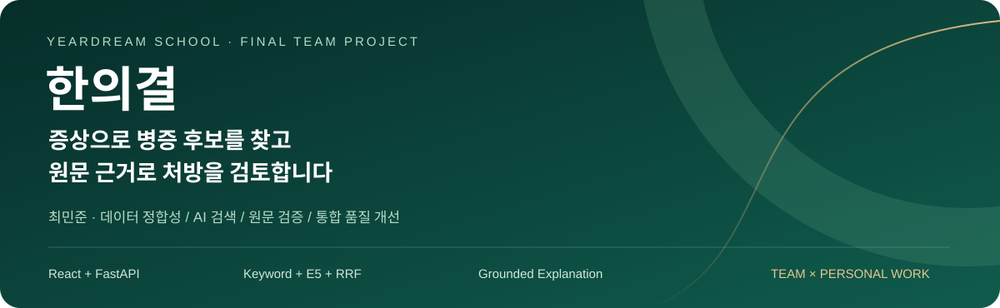
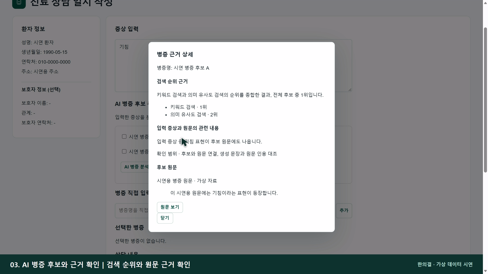
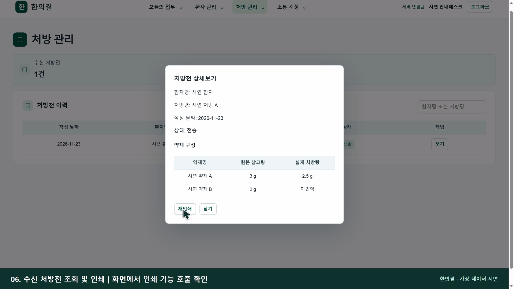

# 한의결 · 한의사 처방 검토 지원 서비스

환자가 설명한 증상에서 **관련 병증 후보를 검색하고, 기업 원문과 연결 처방을 확인한 뒤 상담·처방 기록으로 이어가는** 웹서비스입니다. 검색 결과를 진단으로 확정하지 않고, 한의사가 후보와 출처를 검토하는 과정을 지원합니다.

이어드림스쿨 6기 스마트제조 **쮼 팀의 공동 프로젝트**를 개인 포트폴리오로 정리한 저장소입니다. 팀 원본의 코드와 이력을 보존하고, **최민준의 데이터·AI 검색·근거 검증·통합 품질 개선 기여**를 별도로 설명합니다.

| 프로젝트 | 내용 |
|---|---|
| 기간 / 팀 | 2026년 11월 / 이상준 · 최민준, 2인 |
| 나의 중심 역할 | 기업 데이터 정합성, 하이브리드 검색, 원문 근거 검사, API 계약과 통합 검증, GPU 비교 측정 |
| 서비스 | React · FastAPI · PostgreSQL |
| AI | multilingual-e5-small · Kiwi · RRF · Qwen3.5-4B GGUF · llama.cpp |
| 구현 범위 | 접수 → 상담 → 후보·근거 확인 → 처방 작성 → 저장·조회·출력 |
| 원본 | [팀 저장소](https://github.com/sanjune2/km-cdss-project) · [제출 기준 커밋](https://github.com/sanjune2/km-cdss-project/tree/c4e08c269d4e8a68451069e998bbb078b75f9874) |

[개인 기여](docs/portfolio/contributions.md) · [구조와 데이터](docs/portfolio/architecture.md) · [문제 해결](docs/portfolio/engineering-notes.md) · [검증 결과](docs/portfolio/verification.md) · [실행 조건](docs/portfolio/running.md)

## 사용자에게 제공하는 것

| 사용자 | 필요한 일 | 제공하는 기능 |
|---|---|---|
| 안내데스크 | 접수와 진료 이후 업무를 이어가기 | 환자 등록·검색, 상담 대기 등록, 수신 처방전 조회·출력 |
| 한의사 | 증상에서 검토할 후보와 근거 찾기 | 상담 기록, 병증 후보 검색, 검색 순위·원문 근거 확인, 연결 처방·약재 구성 검토 |
| 한의사 | 실제 작성한 처방을 정확히 남기기 | 원본 참고량과 실제 처방량·단위 분리, 저장·정정·이력 조회 |
| 원장 | 직원의 서비스 사용 관리 | 직원 초대, 가입 승인, 직무·이용 상태 관리 |

## 핵심 화면

아래 이미지는 **팀원이 제작한 가상 데이터 시연영상에서 추출한 실제 서비스 화면**입니다. 화면의 환자·병증·처방 이름과 설명은 시연 자료이며, 실제 모델의 정확도 평가 결과와 구분합니다.

### 1. 후보를 고른 이유와 원문을 함께 확인

검색 순위와 원문 근거를 구분해 제공합니다. 생성된 설명을 확인하더라도 출처로 돌아가 검토할 수 있도록 구성했습니다.



### 2. 원본 참고량과 실제 처방량을 분리해서 입력

기업 자료에 있는 양은 참고값으로 유지하고, 한의사가 작성한 양과 단위는 별도 값으로 저장합니다.


### 3. 전달된 처방전에서도 입력값을 확인

안내데스크의 재조회 화면에서 작성 날짜, 원본 참고량, 실제 처방량과 미입력 상태를 구분합니다.



[팀 시연영상 6개](docs/제출자료/03_최종발표/시연영상/) · [영상이 내장된 최종 발표자료](docs/제출자료/03_최종발표/스마트제조_쮼_최종평가%20발표자료.pptx)

## 내가 집중한 구현

**검색에서 근거까지 연결하기.** 기업의 병증·키워드·처방 연결 관계를 검증하고, 키워드 순위와 E5 의미 검색 순위를 RRF로 결합했습니다. 선택한 병증에 실제로 연결된 처방만 비교하고, 파일 해시·시트·행·원문 구간을 따라 출처를 확인하도록 구성했습니다.

**설명보다 원문 검사를 먼저 두기.** 후보·출처 관계, 생성 결과 형식과 인용 문자열을 검사한 뒤 별도 모델 호출로 문장을 검토합니다. 원문과 맞지 않는 인용은 설명을 반환하지 않고 사유를 안내하며, 해당 실패 응답은 검토 호출로 넘기지 않습니다. 이 검사는 임상적 적합성 판정을 대신하지 않습니다.

**서비스에서 값과 상태를 보존하기.** 팀원 UI 작업과 충돌하지 않도록 백엔드 수정과 화면의 데이터 표시 수정을 분리했습니다. 실제 처방량의 저장·재조회, 저장된 상담의 상태 보호, 증상 문맥 전달, 선택 설명 우선 처리와 검증 결과 캐시를 개선했습니다. [변경 근거와 역할 구분](docs/portfolio/contributions.md)

## 검증과 성능

| 기준 | 확인한 결과 | 해석 범위 |
|---|---|---|
| 11/23 통합 검증 | 백엔드 82개, 프런트엔드 5개 통과 · 빌드 통과 | 당시 `c9f3636` 기준, PostgreSQL 검사 포함 |
| 11/25 제출 전 재확인 | 백엔드 60개 통과 · DB 검사 22개 생략 · 프런트엔드 5개 및 빌드 통과 | `421c48b` 기준, 이번 실행에서 DB 접속은 하지 않음 |
| Elice GPU 비교 | 설명 생성·검토 중앙값 CPU 303.513초 → GPU 12.753초 | A100 **MIG 10GB**, 동일 후보 3개를 각 1회 비교 |

GPU의 중앙값 비율은 약 **23.8배**, 세 후보 순차 합계 비율은 약 **8.99배**였습니다. 첫 GPU 요청 72.887초도 포함한 결과입니다. 전체 서비스 응답 시간·동시 접속 성능이나 검색·임상 정확도의 개선을 뜻하지 않습니다. [전체 측정값과 조건](docs/portfolio/verification.md)

## 코드 탐색

```text
backend/
├── main.py                      업무 API·인증·상담·처방 처리
├── catalog.py                   기업 조회 자료와 원본 정합성
├── ai/                          문맥·후보 검색·출처·설명 검증
├── scripts/                     검색 자료 검사·Elice 실행·비교 도구
└── tests/                       단위·PostgreSQL 회귀 검사
frontend/
├── src/                         역할별 업무 화면
└── tests/                       처방량 표시 및 브라우저 회귀 검사
docs/
├── portfolio/                   개인 기여·구조·문제 해결·검증 설명
└── 제출자료/                    팀 최종 산출물과 고정 소스 스냅샷
```

**실행·개발용 소스**는 루트의 `backend/`와 `frontend/`입니다. 제출자료 안의 소스는 제출 당시의 보관본입니다. 실행에는 별도의 DB·허가된 기업 자료·모델 캐시와 비공개 설정이 필요합니다. [실행 조건과 테스트 방법](docs/portfolio/running.md)

## 출처와 공개 범위

서비스 전체는 팀 공동 결과물입니다. UI·업무 API·DB 연동과 시연영상은 팀원의 주된 작업이며, 검색·데이터·검증을 중심으로 한 제 기여와 구분했습니다. 원본에 없는 라이선스를 새로 부여하지 않았습니다. [출처·기여·공개 자료 안내](docs/portfolio/provenance.md)

실제 환경설정, DB 백업, 기업 원본 데이터·벡터 파일, 모델 가중치, 개인키, 발표대본과 PPT 발표자 노트는 공개 산출물에 포함하지 않았습니다.
