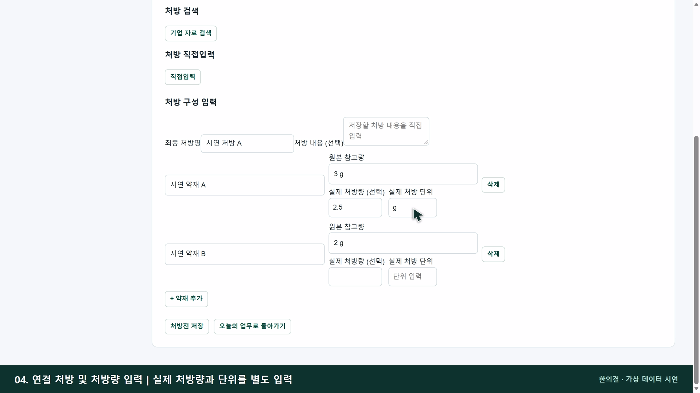

# 한의결 | 최민준 프로젝트 포트폴리오

> 증상으로 병증 후보를 찾고, 원문 근거로 처방을 검토합니다.

**한의결**은 환자가 설명한 증상에서 관련 병증·처방 후보를 찾고, 원문을 확인한 뒤 상담과 처방 기록으로 이어가는 웹서비스입니다. 이어드림스쿨 6기 **쮼 팀의 2인 프로젝트**이며, 저는 **기업 데이터 정합성·AI 검색·근거 검증·서비스 통합 품질 개선**을 중심으로 참여했습니다.

| 항목 | 내용 |
|---|---|
| 개발 기간 | 2026년 11월 |
| 팀 | 이상준 · 최민준 |
| 나의 역할 | 데이터 검증, 병증·처방 검색, 원문 근거 연결, API 계약, 회귀 검사, GPU 비교 측정 |
| 서비스 기술 | Python · FastAPI · React · PostgreSQL |
| 검색·AI 기술 | Kiwi · multilingual-e5-small · RRF · Qwen3.5-4B GGUF · llama.cpp |

[개인 기여 상세](docs/portfolio/contributions.md) · [구조와 데이터](docs/portfolio/architecture.md) · [문제 해결 기록](docs/portfolio/engineering-notes.md) · [검증 결과](docs/portfolio/verification.md)

## 어떤 문제를 해결했나요?

한의사가 증상과 관련된 자료를 검토하려면 **병증 후보 탐색 → 처방과 약재 구성 확인 → 원문 대조 → 실제 처방 기록**을 이어갈 수 있어야 합니다. 후보 이름이나 AI 설명만 제공하면, 그 결과가 어디에서 왔는지와 무엇을 근거로 삼았는지 다시 확인해야 합니다.

이 프로젝트에서는 검색 결과에 **원문 위치와 연결 관계**를 붙이고, 원본 자료의 참고량과 실제 작성한 처방량을 구분했습니다. AI는 검토할 정보를 정리하고, 최종 판단과 처방 작성은 한의사가 수행하는 흐름으로 설계했습니다.

- **안내데스크:** 환자 접수·대기 등록, 전달받은 처방전 조회·출력
- **한의사:** 상담 기록, 병증·연결 처방 검색, 근거 확인, 실제 처방 작성
- **원장:** 직원 초대·가입 승인, 직무·이용 상태 관리

## 제가 맡은 일

| 담당 영역 | 수행한 작업 |
|---|---|
| 기업 데이터 검증 | 식별자·중복·참조 관계, 원문과 청킹·벡터 정합성 대조 |
| 병증·처방 검색 | 키워드 검색과 E5 의미 검색의 RRF 결합, 선택 병증의 연결 처방 범위 적용 |
| 근거·설명 검사 | 파일 해시·시트·행·원문 구간 연결, 인용 일치 검사와 별도 프롬프트 검토 |
| 서비스 통합 | AI 입출력·설명 상태·검색 이력 식별자 계약, 상담 상태와 처방량 저장·조회 개선 |
| 검증·실행 환경 | 회귀 검사, 선택 설명 우선 처리와 캐시 검증, Elice CPU/GPU 비교 |
| 결과 정리 | 검증 조건과 한계 기록, 설계·발표·시연·제출 자료 정리 |

**팀원은 UI·업무 API·DB 연동과 시연영상 제작을 주로 담당**했습니다. 사용자 흐름과 API 연결, 최종 통합은 협업했으며 서비스 전체를 개인 단독 구현으로 설명하지 않습니다. [역할과 변경 근거](docs/portfolio/contributions.md)

## 구현에서 중요하게 본 선택

| 과제 | 선택한 방법 | 이유 |
|---|---|---|
| 등록 용어와 다른 증상 표현 검색 | 키워드 검색 + E5 의미 검색 + RRF | 등록 표현과 의미 유사도를 함께 활용하고 서로 다른 순위 결과를 결합 |
| 검색 결과의 출처 확인 | 파일 해시·원문 위치·조각 범위를 후보에 연결 | 결과를 원본 자료로 추적하고 원문·벡터 버전 혼용을 검사 |
| 생성 설명의 원문 부합 | 관계 검사 → 생성 → 인용 검사 → 별도 검토 | 생성 문장을 바로 노출하지 않고 형식·출처·인용을 단계별로 확인 |
| 원본 자료와 실제 입력값 보존 | 참고량·실제 처방량·단위를 별도 처리 | 자료에 있는 양과 사용자가 작성한 양의 의미를 구분 |
| 설명 대기 시간 개선 | 선택 처방 우선 처리, 검증된 완성 결과 캐시, 상주 GPU 서버 구성 | 검증 절차를 유지하면서 반복 처리와 대기 순서를 개선 |

초기 검색 범위는 선정한 **병증 44개·연결 고유 처방 417개**이며, 원문 조각은 **286개**, E5 벡터는 **384차원**입니다. 전체 기업 데이터의 규모나 정확도 수치가 아닙니다. 현재 검색 런타임은 JSONL·NumPy 벡터 행렬을 사용하며 업무 DB의 PostgreSQL 구성과 구분합니다. [데이터 사용 과정과 구조](docs/portfolio/architecture.md)

## 대표적인 문제 해결

### 1. 입력한 실제 처방량이 재조회에서도 같은 의미로 남도록 개선

과거 상담과 안내데스크의 표시 경로에서 실제 처방량이 누락되거나 원본 참고량과 혼동될 수 있는 부분을 확인했습니다. **저장 값·API 응답·공통 표시 함수를 함께 대조**하고, 실제 값이 없는 경우에는 참고량으로 대체하지 않고 `미입력`으로 구분했습니다.

백엔드 수정과 화면의 데이터 표시 수정을 분리해 팀원의 UI 배치·스타일 작업과 충돌을 줄였습니다.

### 2. 원문과 맞지 않는 생성 인용을 사용자에게 내보내지 않도록 처리

후보·출처 관계와 생성 응답의 식별자·인용 문자열을 검사했습니다. **원문과 일치하지 않는 인용은 설명을 반환하지 않고 사유를 안내**하며, 그 실패 응답을 다음 검토 호출로 넘기지 않도록 처리했습니다.

통과한 응답은 별도 프롬프트로 다시 검토합니다. 이 단계는 다른 독립 모델이나 임상 전문가의 검증을 뜻하지 않습니다.

### 3. 인스턴스에서 실제 추론까지 확인하며 GPU 실행 조건 해결

GPU 장치가 조회돼도 glibc·libstdc++·CUDA PTX 호환 조건 때문에 모델 실행이 실패할 수 있었습니다. 실행 파일과 모델의 버전·해시를 고정하고, **호환 라이브러리는 전용 폴더와 해당 모델 프로세스에만 적용**했습니다.

실제 레이어 offload와 생성·인용·검토 결과를 확인한 뒤, 같은 후보와 검사 조건으로 CPU/GPU 시간을 비교했습니다. [문제 해결 상세](docs/portfolio/engineering-notes.md)

## 확인한 결과

| 검증 | 결과 | 조건 |
|---|---|---|
| 11/23 기능 통합 | 백엔드 **82개**, 프런트엔드 **5개** 통과 · 빌드 통과 | `c9f3636` 기준, PostgreSQL 검사 포함 |
| 11/25 제출 전 재확인 | 백엔드 **60개 통과·22개 생략**, 프런트엔드 **5개** 및 빌드 통과 | `421c48b` 기준, DB 비의존 검사만 재실행 |
| Elice 설명 생성·검토 | 중앙값 **303.513초 → 12.753초** | A100 **MIG 10GB**, 2 vCore, 동일 후보 3개를 CPU·GPU에서 각 1회 |

GPU 중앙값 비율은 약 **23.8배**, 세 후보 순차 합계 비율은 약 **8.99배**였습니다. 첫 GPU 요청 **72.887초**도 결과에 포함했습니다. 이 수치는 설명 생성·검토 구간의 소규모 비교이며 **전체 서비스 응답·동시 접속 성능·검색 및 임상 정확도**로 확대하지 않습니다. [측정 원시 값과 검사 범위](docs/portfolio/verification.md)

## 서비스 화면과 시연

팀원이 제작한 최종 시연영상의 실제 화면입니다. 환자·병증·처방·약재는 **가상 데이터**이며 모델 품질 평가 자료와 구분합니다.

<strong>병증 후보의 검색 순위와 원문 근거 확인</strong>

<strong>원본 참고량과 실제 처방량·단위 분리 입력</strong>

<strong>안내데스크의 처방전 재조회</strong>

[시연영상 6개](docs/제출자료/03_최종발표/시연영상/) · [최종 발표자료](docs/제출자료/03_최종발표/스마트제조_쮼_최종평가%20발표자료.pptx)

## 프로젝트를 통해 배운 점

- **검색·생성·업무 기록은 각각 검증해야 합니다.** 후보가 반환되거나 설명이 생성됐다는 사실만으로 검색 품질과 저장 이력의 정확성이 보장되지 않았습니다.
- **성능 수치에는 시작 조건과 측정 구간이 필요합니다.** 모델 준비·첫 요청·반복 요청을 구분하고, 빠른 일부 요청만으로 전체 서비스 성능을 설명하지 않았습니다.
- **협업에서는 데이터의 의미와 변경 범위를 먼저 맞추는 것이 중요했습니다.** 원본량과 실제 입력량, 상담 저장과 진료 완료를 구분하고 백엔드와 UI 변경을 나눠 통합했습니다.

신규 문장의 독립 정답 평가, 동시 접속 성능과 인스턴스의 전체 서비스 연결 검증은 후속 과제로 구분했습니다.

## 코드와 자료

- **실행용 코드:** [백엔드](backend/) · [프런트엔드](frontend/)
- **개인 작업 설명:** [기여 상세](docs/portfolio/contributions.md) · [구조](docs/portfolio/architecture.md) · [문제 해결](docs/portfolio/engineering-notes.md)
- **검증과 재현:** [검증 조건](docs/portfolio/verification.md) · [실행 환경](docs/portfolio/running.md)
- **팀 산출물:** [요구사항·UI·ERD·API·WBS](docs/제출자료/02_설계및관리자료/) · [제출 안내](docs/제출자료/README_제출안내.md)
- **출처:** [팀 원본 저장소](https://github.com/sanjune2/km-cdss-project) · [자료·기여·공개 범위](docs/portfolio/provenance.md)

이 저장소는 팀 원본의 코드와 이력을 보존한 개인 포트폴리오입니다. 실제 DB·기업 원본·모델 파일과 비공개 설정은 포함하지 않았으며, 실행에는 해당 자료와 환경 구성이 필요합니다.
