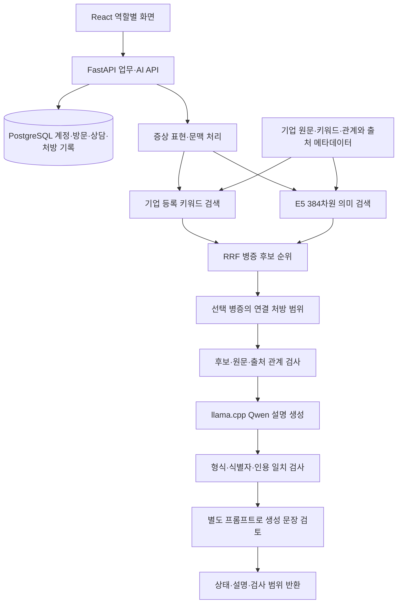

# 서비스 구조와 기업 데이터 사용

## 사용자 흐름

검색은 한의사의 검토 단계를 지원합니다. 후보가 반환된 사실만으로 진단·처방을 확정하지 않습니다.

## 실행 계층

업무 DB에는 PostgreSQL을 사용합니다. **현재 공개 검색 런타임은 JSONL 자료와 NumPy 벡터 행렬을 읽어 E5 검색을 수행**합니다. ERD·개발 DB에 pgvector 구조가 있다는 이유로 현재 검색이 전부 DB의 pgvector에서 실행된다고 설명하지 않습니다. 구현은 [`backend/ai/runtime.py`](../../backend/ai/runtime.py)에서 확인할 수 있습니다.

## 기업 데이터에서 무엇을, 어떻게, 왜 사용했나

| 사용한 정보 | 처리 방법 | 사용자에게 주는 의미 |
|---|---|---|
| 병증명과 증상 기술 | 등록 키워드와 의미 검색의 입력으로 정리 | 증상 표현에서 검토할 병증 후보 탐색 |
| 병증–처방 연결 관계 | 선택 병증에 실제 연결된 처방만 비교 | 관계가 없는 처방을 임의로 생성하지 않음 |
| 처방–약재 구성과 원본량·단위 | 원본 값을 보존해 화면에 제공 | 참고 자료를 보고 실제 처방을 별도로 작성 |
| 원문·파일·시트·행·셀 위치 | 원문 조각·식별자와 함께 반환 | 검색·설명을 원본 위치로 추적 가능 |
| 파일 해시·조각 범위 | 원문과 청킹·벡터 정합성 검사 | 서로 다른 버전의 원문과 벡터 혼용 탐지 |

초기 병증 검색 범위는 감기·두통·소화불량에서 선정한 **병증 44개와 연결 고유 처방 417개**입니다. 검색용 원문 조각은 **286개**, E5 벡터 차원은 **384**입니다. 이 수치는 기업 전체 자료의 규모나 검색 정확도를 뜻하지 않습니다. 전체 처방·약재 조회 자료와 초기 후보 검색 범위도 구분합니다.

## 설명을 반환하는 조건

1. 후보·원문·출처 식별자와 관계가 확인돼야 합니다.
2. 생성 응답의 구조와 후보 식별자가 맞아야 합니다.
3. 인용 문자열이 해당 원문과 일치해야 합니다.
4. 별도 검토 응답도 문장·출처 식별자와 판정 조건을 충족해야 합니다.

원문과 맞지 않는 인용은 **설명을 반환하지 않고 사유를 안내하며 검토 호출도 진행하지 않습니다.** 자료 부족, 검토 불가와 성공 상태를 구분합니다. 문자열·관계 검사와 모델의 근거 검토는 임상적 효과·적합성을 검증하는 절차와 다릅니다.

## 처방 기록의 데이터 경계

- **원본 참고량:** 기업 원문에서 가져온 양과 단위입니다.
- **실제 처방량:** 한의사가 입력한 양과 단위입니다.
- **미입력:** 실제 값이 없으면 참고량으로 자동 대체하지 않습니다.
- **정정 이력:** 저장된 버전과 재조회 결과를 함께 확인합니다.

원본 참고량과 실제 처방량은 서로 다른 의미의 값이므로 자동 단위 환산이나 무조건적인 복사로 합치지 않습니다.
